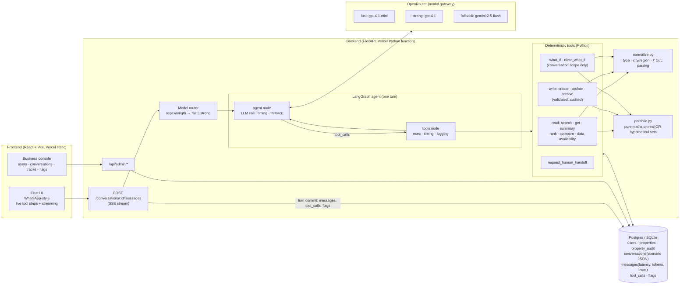

# Architecture

## One turn, step by step

1. **Save and load.** The UI posts the message. The backend opens one DB transaction, saves the user message and loads the last turns of history (the last 2 with tool calls, older ones as text).
2. **Build the prompt.** The system prompt holds the static rules, then the user profile, the **property index** (IDs and labels, no numbers) and the active what-if summary.
3. **Pick a model.** The router chooses fast or strong (about 0 ms, no LLM call) and records the reason.
4. **Run the graph.** The LangGraph loop runs: the model picks tools, the tools run (about 1 ms each), and their results go back to the model, up to 6 steps.
   - Each tool step streams to the UI as `tool_start` and `tool_end`, and answer tokens stream as `token`.
   - If a model call fails, the fallback model retries the same step.
5. **Commit and flag.** One commit saves the assistant message (latency split, tokens, model, route, trace), the tool calls (args, result, duration) and the flags.
   - Auto-flags: error, data gap, blocked write, no answer, or a request for a human.
   - If anything failed, property writes from this turn are rolled back.
6. **Admin view.** The business console reads the same tables. It shows each turn's latency bar (model vs tools vs other), the route and reason, every tool call with its arguments and result, saved changes, the active scenario and the flags.

## Data model

| Table | Purpose |
|---|---|
| `users` | Seeded from users.csv; value preference parsed into min/max |
| `properties` | Normalised: `property_type` (+ `_raw`), `locality`, `city`, `state`, `status` Active/Archived |
| `property_audit` | Every write: action and `{field: [old, new]}`, linked to the conversation |
| `conversations` | `scenario` JSON = hypothetical changes (never applied to `properties`) |
| `messages` | Content plus observability: model, route, route_reason, llm_calls, total/model/tool/first-token latency, tokens, error, LangChain trace |
| `tool_calls` | Per call: step, name, args, result, duration_ms, error |
| `flags` | kind (error / handoff / data_gap / unanswered / write_blocked / manual), severity, source (auto / agent / admin), resolved |
